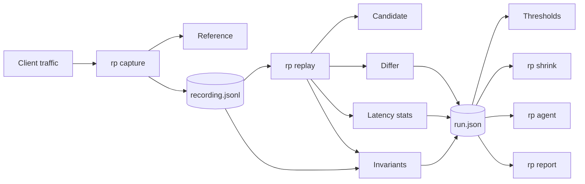
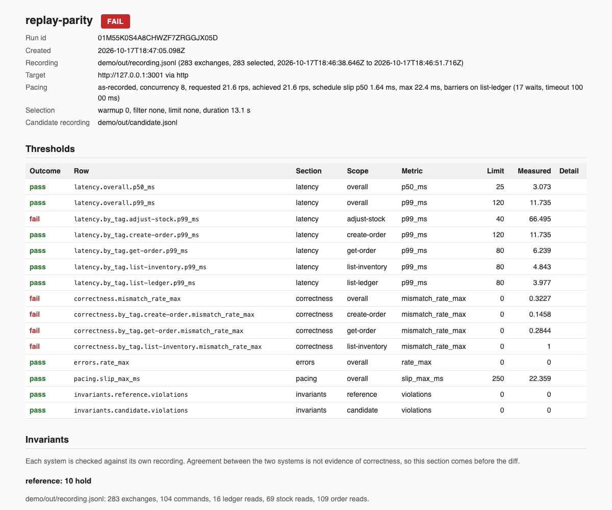

# replay-parity

replay-parity records real traffic against a reference system, replays it against a candidate, diffs every response under rules that are data, gates on latency and correctness, checks each system against its own invariants, reduces a failure to a reduced reproduction, and asks a model for sharper cases. It answers one question: does the new system behave like the old one on real traffic, fast enough. It is a TypeScript monorepo with one command, `rp`, and a demo that runs end to end with `make demo`.

## Architecture



The capture proxy writes one JSON Lines exchange per request. The replay engine sends the recording to the candidate on a schedule, keeps the recorded order, resolves the ids each system assigns, and hands every response pair to the differ. Statistics, thresholds, and invariants decide the verdict. The run file is the canonical report and the HTML is rendered from it. `docs/architecture.md` has the longer version.

## The report



## The demo

```sh
pnpm install && make demo
```

With Docker and pnpm installed, `make demo` builds the workspace, starts the reference and three candidates with docker compose, records the load generator's 283 exchanges through the capture proxy, and runs three replays with `as-recorded` pacing. The first replay targets the candidate with the four planted divergences and fails on all four. The second targets the clean candidate started with `DIVERGENCES=off` and passes with every invariant holding on both sides. The third targets a candidate with one seeded defect, fails on the invariants, and is reduced by `rp shrink` to four steps. It writes `demo/out/report.html`, `report-unordered.html`, `report-clean.html`, and `report-defect.html`, prints the terminal summary of each, and runs the agent when `ANTHROPIC_API_KEY` is set. `DIVERGENCES=off make demo` makes the first replay pass. `make demo-down` stops the containers. `demo/README.md` walks through every report with screenshots, and `docs/oms-mapping.md` maps the demo onto an order management system migration for readers from that world.

The committed `demo/recording.jsonl` replays without Docker:

```sh
pnpm build
node packages/cli/dist/src/main.js replay --recording demo/recording.jsonl --target http://127.0.0.1:3001 \
  --rules demo/diff-rules.yaml --thresholds demo/thresholds.yaml --barrier-tag list-ledger --invariants --out run.json
node packages/cli/dist/src/main.js report --run run.json --out report.html
```

## The four divergences

The candidate service is derived from the reference and differs only at marked lines. A guard fails when the two differ anywhere else.

| Divergence | What the candidate does                                                | How the report shows it                                                                                                                                                                                            |
| ---------- | ---------------------------------------------------------------------- | ------------------------------------------------------------------------------------------------------------------------------------------------------------------------------------------------------------------ |
| Rounding   | Rounds order totals half to even instead of half up.                   | Seven `create-order` and twenty three `get-order` exchanges mismatch on `$.total` by one cent, listed in the correctness drill down with both values side by side.                                                 |
| Ordering   | Returns inventory rows in insertion order instead of SKU order.        | Under `demo/diff-rules.yaml` all 53 `list-inventory` reads mismatch on `$.items[*]`. Under `demo/diff-rules-unordered.yaml`, which compares the rows as a set keyed by `$.sku`, they match. The demo renders both. |
| Latency    | Sleeps 60 ms on a seeded five percent of `adjust-stock` calls.         | The threshold row `latency.by_tag.adjust-stock.p99_ms` fails at about 70 ms against 40, and the latency table and histogram for the tag show the tail.                                                             |
| Behavior   | Answers 200 with an empty body for an unknown order id instead of 404. | Eight `get-order` exchanges mismatch on `status` and on the missing body.                                                                                                                                          |

## The agent

`rp agent` summarizes the run and the recording's request shapes, asks a model for new cases as JSON, validates them, sends each to the reference and the candidate, and keeps the ones that reveal a mismatch path set or a latency breach no kept case already reveals. It stops when a round adds nothing, when the next call could cross the budget, or at the round limit, and it prints the tokens and dollars it spent. In the demo run it reproduced the rounding, the unknown id, and the ordering divergences from the summary alone in the first round, for three and a half cents over two rounds. `docs/agent-loop.md` explains the loop, shows the real transcript, and says where the agent is noisy. Without a key the command prints a message and exits 0.

## Measured

Apple M4 Max, 16 cores, 64 GB, Docker Desktop 29.4.1 with a linux/aarch64 engine, both services in containers.

| Measurement       | Command              | Result                                                                                                                                                                                                                                                                                     |
| ----------------- | -------------------- | ------------------------------------------------------------------------------------------------------------------------------------------------------------------------------------------------------------------------------------------------------------------------------------------ |
| Capture overhead  | `make bench-capture` | p50 0.26 to 0.31 ms direct against 0.54 to 0.59 ms through the proxy: 0.28 ms of overhead at p50 and 1.06 ms at p99, over 5000 requests at concurrency 8 after 500 warmup, two passes each.                                                                                                |
| Replay throughput | `make bench-replay`  | 2600 to 3200 requests per second against the clean candidate at `max` pacing and concurrency 8 over the committed recording, with zero mismatches. The recording is sequential and the engine keeps that order, so the rate is bounded by the candidate's latency rather than by the pool. |
| Demo wall time    | `make demo`          | 1 minute 25 seconds without the agent and 1 minute 39 seconds with it, images already built.                                                                                                                                                                                               |

## Design notes

**JSON Lines.** One exchange per line, append only, valid when every line parses and the offsets never decrease. A capture that dies loses one line. The reader streams, so recordings larger than memory still replay, and a recording can be filtered, sampled, and diffed in git with ordinary tools.

**Rules are data.** `diff-rules.yaml` names what to ignore, which numbers tolerate how much, which arrays are sets and by which key, which statuses are equivalent, which headers to compare, which values are substituted, and which tags are harness controls. Every finding names the path, both values, and the rule that tolerated it, in a deterministic order. `examples/diff-rules.yaml` and `examples/thresholds.yaml` explain every key.

**Stateful sequences.** A substitution rule captures a value, such as an order id, from every exchange carrying a tag, on the reference from the recording and on the candidate from the replay. Later requests have the reference value replaced with the candidate value in the path, query, and body, and the differ treats the pair as equivalent. Dependencies are computed before anything is sent, so a request waits for its producer under every pacing mode. The engine also keeps the recorded happens-before order, so a slow candidate response never lets a later read overtake the write it followed. Barrier tags make snapshot reads wait for every earlier acknowledgement, and a restart is replayed as a harness control that is shown but not scored.

**Three verdicts.** A run passes, fails, or is inconclusive. Inconclusive means the harness could not decide: a barrier timed out, a snapshot was read while a command was in flight, the schedule was not held, a control failed, or a latency row had fewer successful samples than its minimum. It has its own exit code, 3, and the report names the condition.

**Independent invariants.** Agreement between two systems is not evidence of correctness. Ten invariants are evaluated against each system's own recording, using only that system's acknowledgements, and shown per system above the diff. In the demo they catch each of four seeded defects from the candidate's log alone, and `rp shrink` reduces the failing run to three or four steps that still trip the same rule.

**Adding an adapter.** An adapter implements `send(request, context)` and measures latency from dispatch to the last byte. The engine owns pacing, ordering, substitutions, barriers, the diff, and the gates. `http` ships, and `bus` ships over an in process bus and a Redis Streams bus with a documented responder contract. `docs/writing-adapters.md` has the details.

## Limitations

- The diff rules are global. There is no per tag scope, so the demo shows the ordering divergence with two rules files rather than one.
- The JSONPath subset is `$`, `.name`, `['name']`, `[n]`, `[*]`, and `.*`. Recursive descent, slices, filters, and unions are rejected at load time.
- A body with a `content-encoding` of gzip, deflate, or br is decoded before it is stored and compared. Any other coding is stored and compared as the bytes received.
- The engine never introduces an ordering the recording did not have. Replaying a sequential recording therefore runs one request at a time regardless of `--concurrency`, and the throughput figure above reflects that.
- The invariants encode the demo's order lifecycle. Another domain needs its own rules, and the package shows the shape.
- Shrinking needs a way to reset the candidate between attempts. The demo uses `POST /admin/reset`.
- An agent case runs at most 50 times, so a latency tail that fires on a few percent of calls is reachable and one that fires on one call in a thousand is not.
- The Redis Streams bus test needs a server at `REDIS_URL`. CI starts one as a service container and sets the variable, so the test runs on every push. Without the variable the test is skipped and the in process bus covers the adapter.
- The capture proxy and the HTTP adapter speak HTTP/1.1 without client certificates.
- Everything was measured and run on one machine. CI runs the suite and the demo on Linux, and nothing has been tried on Windows.

## Repository

| Path                  | Contents                                                                                                  |
| --------------------- | --------------------------------------------------------------------------------------------------------- |
| `packages/core`       | Recording format, JSONPath subset, differ, statistics, thresholds, run model and schema                   |
| `packages/capture`    | The recording reverse proxy                                                                               |
| `packages/replay`     | The replay engine and the `http` and `bus` adapters                                                       |
| `packages/invariants` | The independent invariants                                                                                |
| `packages/shrink`     | Delta debugging to a reduced reproduction                                                                 |
| `packages/report`     | HTML, JSON, and terminal renderers                                                                        |
| `packages/agent`      | The model driven case generator                                                                           |
| `packages/cli`        | The `rp` command                                                                                          |
| `demo`                | The two services, the load generator, the compose file, the rules and thresholds, the committed recording |
| `docs`                | Architecture, report format, adapters, the agent loop, the OMS mapping, screenshots                       |
| `fixtures/defects`    | One cause file per seeded defect                                                                          |

`make check` runs lint, typecheck, the tests, and the three guards. `CHANGELOG.md` records what each build step added, and `DEFERRED.md` lists what was noticed and left out.

## License

MIT.
