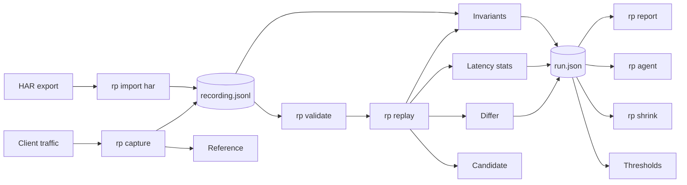

# replay-parity

replay-parity records real traffic against a reference system, replays it against a candidate, diffs every response under rules that are data, gates on latency and correctness, checks each system against its own invariants, reduces a failure to a reduced reproduction, and asks a model for sharper cases. It answers one question: does the new system behave like the old one on real traffic, fast enough. It is a TypeScript monorepo with one command, `rp`, and a demo that runs end to end with `make demo`.

## Architecture



The capture proxy writes one JSON Lines exchange per request and streams bodies through a capped hash, so a body of any size costs at most the cap in memory. It can listen over HTTPS and connect to an https reference, keep whole sessions when it samples, write numbered gzip parts, redact bodies by rule, and start the file with a manifest that says how it was made. `rp import har` writes a recording from a HAR file when no proxy can be placed in front of the reference. `rp recording` validates, summarizes, filters, samples, splits, merges, scans, migrates, and anonymizes a recording without replaying it. `rp validate`, and the same preflight inside `rp replay`, `rp shrink`, and `rp agent`, checks the rules file, the thresholds file, and the barrier tags the command takes against the recording before anything is sent, and `rp rules lint` and `rp rules suggest` help write the rules. The replay engine streams the recording through a window and sends it to the candidate on a schedule, keeps the recorded order within each session, resolves the ids each system assigns, can send every exchange to the reference as well to tell noise apart, can retry a send that failed in transport, and hands every response pair to the differ. Statistics, thresholds, a baseline, and invariants decide the verdict. The run file is the canonical report and carries the hash of the recording it replayed. The HTML, JUnit, Markdown, and terminal views are rendered from it, `rp compare` sets two runs side by side, and a long run streams its results to a sidecar and can be resumed after a stop. Every flag can also come from `rp.yaml`, a profile in it, or an `RP_` variable, and the logger, the progress line, the trace header, and the metrics endpoint show a run while it goes. `docs/architecture.md` has the longer version, and `docs/adr/` holds one record for each decision in it.

## The report


## The demo

```sh
pnpm install && make demo
```

With Docker and pnpm installed, `make demo` builds the workspace, starts the reference and three candidates with docker compose, records the load generator's 283 exchanges through the capture proxy, and runs three replays with `as-recorded` pacing, taking their shared settings from `demo/rp.yaml` through its `strict` and `unordered` profiles. The first replay targets the candidate with the four planted divergences and fails on all four. The second targets the clean candidate started with `DIVERGENCES=off` and passes with every invariant holding on both sides. The third targets a candidate with one seeded defect, fails on the invariants, and is reduced by `rp shrink` to four steps. It writes `demo/out/report.html`, `report-unordered.html`, `report-clean.html`, and `report-defect.html`, prints the terminal summary of each, and runs the agent when `ANTHROPIC_API_KEY` is set. `DIVERGENCES=off make demo` makes the first replay pass. `make demo-down` stops the containers. `demo/README.md` walks through every report with screenshots, and `docs/oms-mapping.md` maps the demo onto an order management system migration for readers from that world.

The committed `demo/recording.jsonl` replays without Docker:

```sh
pnpm build
node packages/cli/dist/src/main.js replay --recording demo/recording.jsonl --target http://127.0.0.1:3001 \
  --rules demo/diff-rules.yaml --thresholds demo/thresholds.yaml --barrier-tag list-ledger --invariants --out run.json
node packages/cli/dist/src/main.js report --run run.json --out report.html
```

## Running it against a real system

`docs/operations.md` is the runbook. It covers capturing in front of a real reference, running the replay in CI and on a schedule, reading each inconclusive condition and what to change, the exit codes a scheduler should expect, and what to attach to a ticket. `docs/real-system.md` is a walkthrough from an existing HTTP service with authentication to a nightly job, with the demo's files as the worked example. `docs/troubleshooting.md` answers the questions the demo raises, such as why a sequential recording replays sequentially, why a timestamp fails without a rule, and why a barrier timed out.

The reference pages follow. `docs/capture.md` describes the manifest, session sampling, rotation and gzip, body redaction, lossless numbers, and HAR import. `docs/configuration.md` describes `rp.yaml`, profiles, `RP_` variables, `${NAME}` interpolation that keeps secrets out of the file and the run, `rp validate`, the preflight, and `rp doctor`. `docs/recording-tools.md` describes `rp recording` and the recording hash that ties a run to the file it replayed. `docs/diff-rules.md`, `docs/thresholds.md`, and `docs/invariants.md` list every key of the rules, the thresholds, and the invariant rules, and `docs/shrinking.md` describes `rp shrink`. `docs/observability.md` describes the log, the progress line, and the metrics. `docs/release.md` says how to install `rp` with `npx @replay-parity/cli` or from the image on GHCR once a release has been published, and how to verify both. `docs/ci.md` names the CI jobs and the Makefile target behind each, and `rp report --format junit` or `--format markdown` with `--fail-on-verdict` fits a pipeline that renders first and gates second. `SECURITY.md` says what the tool stores, what redaction covers, what the agent sends, and how to report a vulnerability. `CONTRIBUTING.md` says how to work on the repository.

## The four divergences

The candidate service is derived from the reference and differs only at marked lines. A guard fails when the two differ anywhere else.

| Divergence | What the candidate does                                                | How the report shows it                                                                                                                                                                                            |
| ---------- | ---------------------------------------------------------------------- | ------------------------------------------------------------------------------------------------------------------------------------------------------------------------------------------------------------------ |
| Rounding   | Rounds order totals half to even instead of half up.                   | Seven `create-order` and twenty three `get-order` exchanges mismatch on `$.total` by one cent, listed in the correctness drill down with both values side by side.                                                 |
| Ordering   | Returns inventory rows in insertion order instead of SKU order.        | Under `demo/diff-rules.yaml` all 53 `list-inventory` reads mismatch on `$.items[*]`. Under `demo/diff-rules-unordered.yaml`, which compares the rows as a set keyed by `$.sku`, they match. The demo renders both. |
| Latency    | Sleeps 60 ms on a seeded five percent of `adjust-stock` calls.         | The threshold row `latency.by_tag.adjust-stock.p99_ms` fails at about 70 ms against 40, and the latency table and histogram for the tag show the tail.                                                             |
| Behavior   | Answers 200 with an empty body for an unknown order id instead of 404. | Eight `get-order` exchanges mismatch on `status` and on the missing body.                                                                                                                                          |

## The agent

`rp agent` summarizes the run and the recording's request shapes, asks a model for new cases as JSON, validates them, sends each to the reference and the candidate, and keeps the ones that reveal a mismatch path set or a latency breach no kept case already reveals. It stops when a round adds nothing, when the next call could cross the budget, or at the round limit, and it prints the tokens and dollars it spent. In the demo run it reproduced the rounding, the unknown id, and the ordering divergences from the summary alone in the first round, and on its own set `repeat` to 50 on a stock adjustment to show the candidate's p99 tail, for three and a half cents over two rounds with the second round read from the prompt cache. The answer is schema constrained, a declined round is retried on a fallback model inside the same call, each call is estimated from an exact token count before it is made, and `--export-recording` writes the kept cases as a recording the next `rp replay` can take. `docs/agent-loop.md` explains the loop, shows the real transcript, and says where the agent is noisy. Without a key the command prints a message and exits 0.

## Measured

Apple M4 Max, 16 cores, 64 GB, Docker Desktop 29.4.1 with a linux/aarch64 engine, both services in containers. These figures were taken before the second round of enhancements and have not been taken again since. The proxy's body handling changed in that round, so the capture overhead row describes the earlier proxy.

| Measurement       | Command              | Result                                                                                                                                                                                                                                                                                     |
| ----------------- | -------------------- | ------------------------------------------------------------------------------------------------------------------------------------------------------------------------------------------------------------------------------------------------------------------------------------------ |
| Capture overhead  | `make bench-capture` | p50 0.26 to 0.31 ms direct against 0.54 to 0.59 ms through the proxy: 0.28 ms of overhead at p50 and 1.06 ms at p99, over 5000 requests at concurrency 8 after 500 warmup, two passes each.                                                                                                |
| Replay throughput | `make bench-replay`  | 2600 to 3200 requests per second against the clean candidate at `max` pacing and concurrency 8 over the committed recording, with zero mismatches. The recording is sequential and the engine keeps that order, so the rate is bounded by the candidate's latency rather than by the pool. |
| Demo wall time    | `make demo`          | 1 minute 25 seconds without the agent and 1 minute 37 seconds with it, images already built.                                                                                                                                                                                               |

## Design notes

**JSON Lines.** One exchange per line, append only, valid when every line parses and the offsets never decrease. A capture that dies loses one line. The reader streams, so recordings larger than memory still replay, and a recording can be filtered, sampled, and diffed in git with ordinary tools. A first line may be a manifest that says which tool, target, tag rules, redaction, and sampling produced the file, and a path ending in `.gz` is read and written as gzip. `rp recording` does the filtering, sampling, splitting, and merging with the offsets rebased so the result still replays with its original rhythm, and `rp recording scan` says what in a file looks like personal data before it is shared. A JSON number whose text a double would change, such as `1.10` or an integer beyond 2^53, is stored as `{"$num": "<text>"}` and compared by exact decimal value.

**Rules are data.** `diff-rules.yaml` names what to ignore, which numbers tolerate how much, which timestamps and decimals count as equal, which patterns mask a generated value, which arrays are sets and by which key, which statuses are equivalent, which headers to compare, which values are substituted, and which tags are harness controls. A rule can carry a `when` scope of tags, methods, and paths, and a rules file can include shared packs. Every finding names the path, both values, and the rule that tolerated it, in a deterministic order. `examples/diff-rules.yaml` and `examples/thresholds.yaml` explain every key, and `rp rules lint` shows how many recorded exchanges each rule reaches.

**Stateful sequences.** A substitution rule captures a value, such as an order id, from every exchange carrying a tag, on the reference from the recording and on the candidate from the replay. The value comes from the response body, from a response header, or from the request body. Later requests have the reference value replaced with the candidate value in the path, query, and body, and the differ treats the pair as equivalent. Dependencies are computed before anything is sent, so a request waits for its producer under every pacing mode. The engine also keeps the recorded happens-before order within a session, so a slow candidate response never lets a later read overtake the write it followed. `--session-key` names where a request carries its session, and sessions then overlap up to `--concurrency`. Barrier tags make snapshot reads wait for every earlier acknowledgement in every session, and a restart is replayed as a harness control that is shown but not scored.

**Three verdicts.** A run passes, fails, or is inconclusive. Inconclusive means the harness could not decide: a barrier timed out, a snapshot was read while a command was in flight, the schedule was not held, a control failed, the run was stopped by a signal, a latency row had fewer successful samples than its minimum, or a row needed a measurement the run did not take. It has its own exit code, 3, and the report names the condition. A thresholds file can set `inconclusive.max_rows` so that a few rows short of samples do not stop a run in which nothing failed.

**A signal stops the run cleanly.** The first SIGINT or SIGTERM asks the running command to stop and write what it has. A replay sends nothing more, aborts the sends in flight, writes the partial run with an `aborted` condition naming how many of the selected exchanges were sent, and exits 3. A shrink keeps the best reduction found so far, writes the run and the reduced recording, and exits 3. An agent stops at the next case boundary, writes the transcript, the cases, and the agent section with the stop reason `aborted`, and exits 3. A run that streamed its results to a sidecar writes a checkpoint, and `--resume` continues it. A second signal exits at once with 130.

**The run names its recording.** `rp replay` hashes the recording file while it reads it and writes the SHA-256 of its bytes into the run as `recording.recording_sha256`, in constant memory. `rp shrink` hashes the file it is given and refuses one whose hash differs from the run's, naming both hashes, unless `--allow-recording-mismatch` turns the refusal into a warning, so a reduced reproduction is built from the file the run replayed and not from a file that was edited, filtered, or appended since. `--baseline` uses the same hash to refuse an earlier run of a different recording.

**Checks before anything is sent.** `rp validate` parses the recording, the rules, the thresholds, and `rp.yaml`, checks that every tag the thresholds name, every substitution capture tag, every control tag, every rule path, and every barrier tag matches something in the recording, and probes the URLs it is given. `rp replay`, `rp shrink`, and `rp agent` run the same checks first and exit 1 before sending anything when one fails, so a misspelled tag is an error at the start rather than an inconclusive row at the end of a long replay. `--preflight-probe` adds the URL probes, and `--no-preflight` skips the checks, which is how a recording that legitimately lacks a tag is replayed, with the row inconclusive as before. Settings come from four layers, the top level of `rp.yaml`, a profile, `RP_<COMMAND>_<FLAG>` variables, and the flags, and any string among them may hold `${NAME}`, resolved from the environment when the command runs and never written to the run or the candidate recording. `rp doctor` prints the layers in effect with every value unresolved.

**Independent invariants.** Agreement between two systems is not evidence of correctness. Invariants are evaluated against each system's own recording, using only that system's acknowledgements, and shown per system above the diff. The built in module holds the ten rules of the demo's order lifecycle, and another domain loads its own rules from an ES module or from a declarative `invariants.yaml` that needs no code. In the demo they catch each of four seeded defects from the candidate's log alone, and `rp shrink` reduces the failing run to three or four steps that still trip the same rule.

**Adding an adapter.** An adapter implements `send(request, context)` and measures latency from dispatch to the last byte. The engine owns pacing, ordering, substitutions, barriers, the diff, and the gates. `http` ships, with TLS and proxy options, and `bus` ships over an in process bus and a Redis Streams bus, with consumer groups and a documented responder contract. `--adapter-module` loads an adapter of your own from an ES module. `docs/writing-adapters.md` has the details.

**Noise is measured.** With `--reference-target` every exchange also goes to the reference. A path where the reference differs from its own recording moved by itself, as a timestamp does, so the same difference on the candidate is tolerated as noise and counted apart instead of failing the run. A reference that answered another status or gave no answer names no noise, so a broken reference cannot excuse a candidate broken the same way.

**A run is compared with the last one.** `--baseline` gates a run against an earlier run of the same recording, on latency ratios and on growth of the mismatch and error rates, and `rp compare` prints two runs side by side without gating.

**The replay streams.** The engine reads the recording through a window of `--window` exchanges, and above 50000 results the results go to a sidecar next to the run file, so a run of many exchanges writes a run file of kilobytes. The candidate recording and the invariants still read whole recordings.

## Limitations

- The JSONPath subset is `$`, `.name`, `['name']`, `[n]`, `[*]`, and `.*`. Rule paths also accept `[?(@.name=='x')]` filters and `..` recursive descent. Unordered keys, substitution captures, and session selectors take the plain subset only, and slices and unions are rejected at load time.
- A body with a `content-encoding` of gzip, deflate, or br is decoded before it is stored and compared. Any other coding is stored and compared as the bytes received.
- The engine never introduces an ordering the recording did not have. Replaying a sequential recording therefore runs one request at a time regardless of `--concurrency`, and the throughput figure above reflects that. `--session-key` lets independent sessions overlap, and only when the recording carries a session value that capture did not redact.
- The built in invariants encode the demo's order lifecycle. Another domain writes a declarative `invariants.yaml` or a module of its own.
- Shrinking needs a way to reset the candidate between attempts, by URL, shell command, or module. The demo uses `POST /admin/reset`.
- `--reference-target` sends every exchange to the reference again, writes included, so it needs a reference that may take the traffic.
- A resumed run sends the exchanges after its checkpoint again, so a stateful candidate sees them twice unless it is reset, and it cannot write a candidate recording or judge the invariants.
- `rp import` reads HAR 1.2 only. There is no importer for Envoy taps or OpenTelemetry spans and no recorder plugin for a framework, and the replay runs from one process, with no distributed workers, no `--duration`, and no `--ramp`.
- An agent case runs at most 50 times, so a latency tail that fires on a few percent of calls is reachable and one that fires on one call in a thousand is not.
- The Redis Streams bus test needs a server at `REDIS_URL`. CI starts one as a service container and sets the variable, so the test runs on every push. Without the variable the test is skipped and the in process bus covers the adapter.
- The capture proxy and the HTTP adapter speak HTTP/1.1. Both take TLS options, a client certificate, and a private CA through the `--upstream-*` flags, and the adapter takes an http proxy.
- Redaction covers headers and query parameters by name, and the bodies and query parameters a capture rules file names, by `drop` or by a keyed hash. Everything else in a body is stored as received, and an id in a URL path is never redacted, so a recording holds whatever personal data those bodies carried. `rp recording scan` reports what it finds, and `SECURITY.md` says how to treat the file.
- A filtered replay pulls in the producers of the substituted values the filtered exchanges use, so a `get-order` read no longer mismatches on its id or status. A read that followed a shipment, a cancel, or a quantity change in the recording still differs on those lifecycle fields, since nothing it uses is a substituted value: 27 mismatches on the committed recording under `--filter tag=get-order`. `docs/troubleshooting.md` shows how to cut a recording that keeps the lifecycle commands.
- The timing tests judge ordering and spacing from the run's own fields with generous bounds and two retries, because on the macOS development machine a vitest worker stalls for 7 to 10 seconds when another suite runs at the same time. The suite passes under the stall; its cause is open.
- Nothing has been published yet. `npx @replay-parity/cli` and the image on GHCR work once the first release is cut, and until then `rp` runs from a clone with `pnpm build`.
- Everything was measured on one machine. CI runs the suite and the demo on Linux, the unit tests on macOS, and the unit tests on Windows as an informational job that does not block a merge until the suite has been verified there.

## Repository

| Path                             | Contents                                                                                                                                                                                                                                                                                                         |
| -------------------------------- | ---------------------------------------------------------------------------------------------------------------------------------------------------------------------------------------------------------------------------------------------------------------------------------------------------------------- |
| `packages/core`                  | The recording format with its manifest, gzip, lossless numbers, capture rules, and HAR import, the recording hash and the operations behind `rp recording`, the JSONPath subset, the rules schema and differ, statistics, thresholds, the run model with its schema and migrations, the logger and metrics       |
| `packages/capture`               | The recording reverse proxy: streaming bodies through a capped hash, TLS, session sampling, rotation and gzip parts, body redaction                                                                                                                                                                              |
| `packages/replay`                | The replay engine with sessions, the reference re-replay, retries, streaming, and resume, and the `http` and `bus` adapters with plugin loading                                                                                                                                                                  |
| `packages/invariants`            | The invariant module interface, the built in order lifecycle module, and the declarative module                                                                                                                                                                                                                  |
| `packages/shrink`                | Delta debugging to a reduced reproduction, with reset strategies, value lowering, parallel targets, an attempt cache, latency rules, and the recording hash check                                                                                                                                                |
| `packages/report`                | HTML, JSON, JUnit, Markdown, and terminal renderers                                                                                                                                                                                                                                                              |
| `packages/agent`                 | The model driven case generator                                                                                                                                                                                                                                                                                  |
| `packages/cli`                   | The `rp` command: capture, replay, report, compare, invariants, shrink, agent, recording, import, rules, validate, doctor, with `rp.yaml` and the preflight                                                                                                                                                      |
| `demo`                           | The two services, the load generator, the compose file, the rules, thresholds, and `rp.yaml`, the committed recording                                                                                                                                                                                            |
| `docs`                           | Architecture and its decision records, the operations runbook, the real system walkthrough, troubleshooting, capture, configuration, recording tools, rules, thresholds, invariants, shrinking, observability, the report format, adapters, the agent loop, CI, releasing, testing, the OMS mapping, screenshots |
| `examples`                       | `diff-rules.yaml`, `thresholds.yaml`, and `rp.yaml` with every key explained, rule packs, invariants, and an adapter                                                                                                                                                                                             |
| `fixtures/defects`               | One cause file per seeded defect                                                                                                                                                                                                                                                                                 |
| `scripts`                        | The three guards, the demo, the benchmarks, the screenshots, the release dry run                                                                                                                                                                                                                                 |
| `.github`                        | The CI and release workflows, Dependabot, the pull request template, `CODEOWNERS`                                                                                                                                                                                                                                |
| `.changeset`, `Dockerfile`       | The changesets configuration with the pending changeset, and the `rp` image                                                                                                                                                                                                                                      |
| `SECURITY.md`                    | How to report a vulnerability, what the tool stores, what redaction covers, what the agent sends                                                                                                                                                                                                                 |
| `CONTRIBUTING.md`, `DEFERRED.md` | How to set up, test, and submit a change, and what was noticed and left out                                                                                                                                                                                                                                      |

`make check` runs lint, typecheck, the tests, and the three guards, and `make release-check` rehearses a release without publishing anything. `CHANGELOG.md` records what each build step added, `DEFERRED.md` lists what was noticed and left out, and `ENHANCEMENTS_2.md` proposes the second round of work, with a status table that says what has landed. `CONTRIBUTING.md` says how to set up and what a change has to pass.

## License

MIT.
