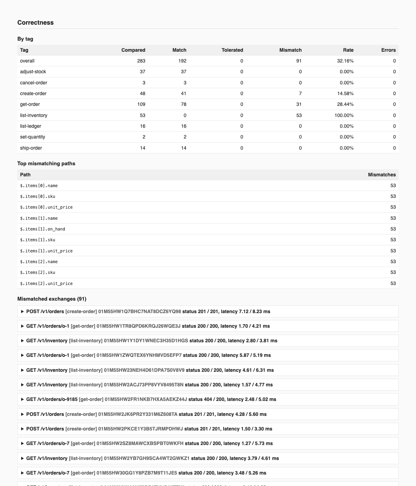
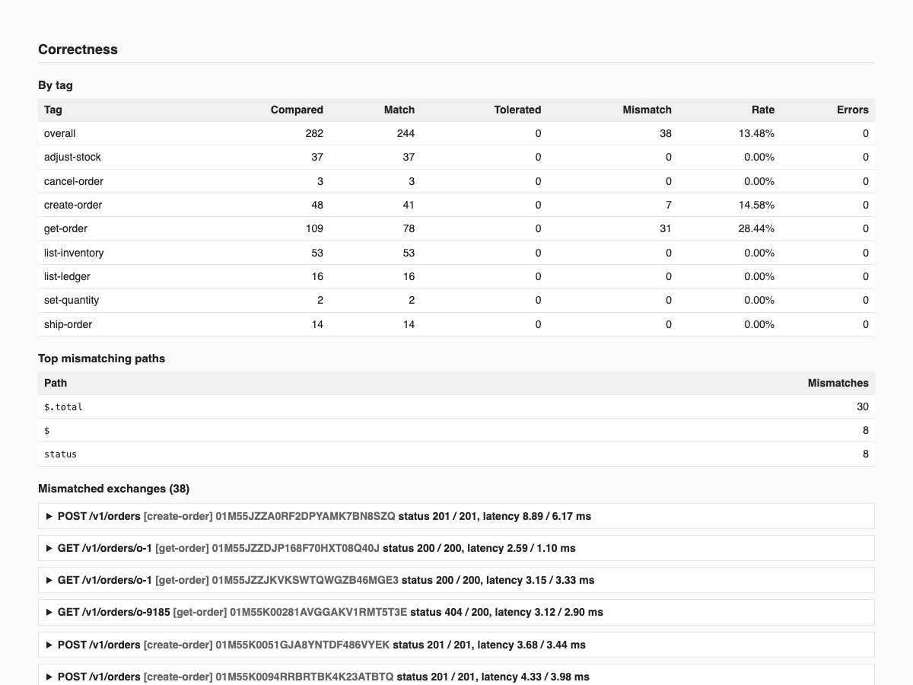
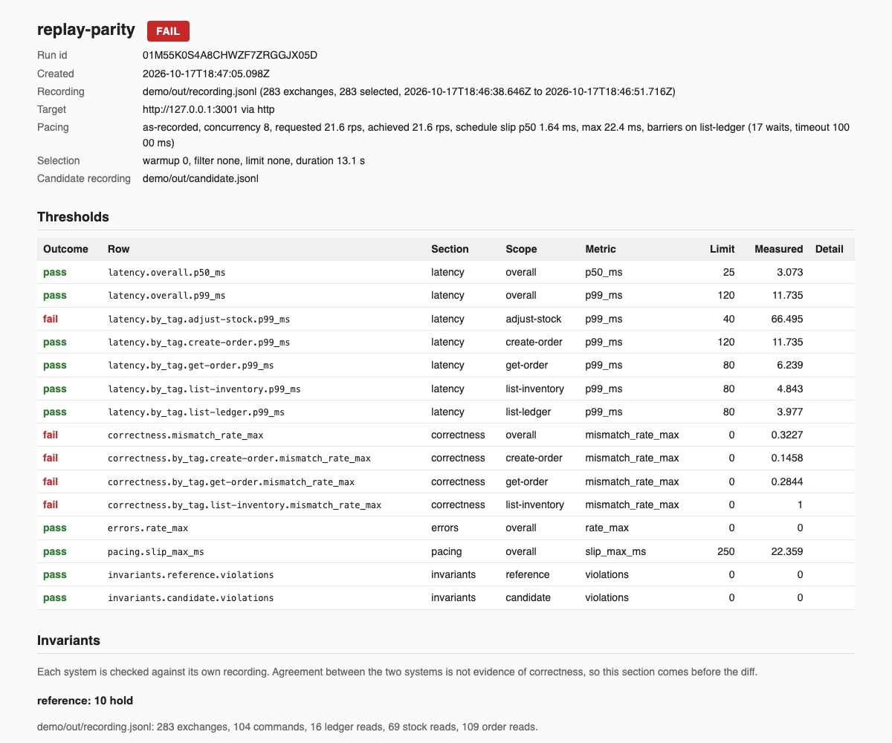
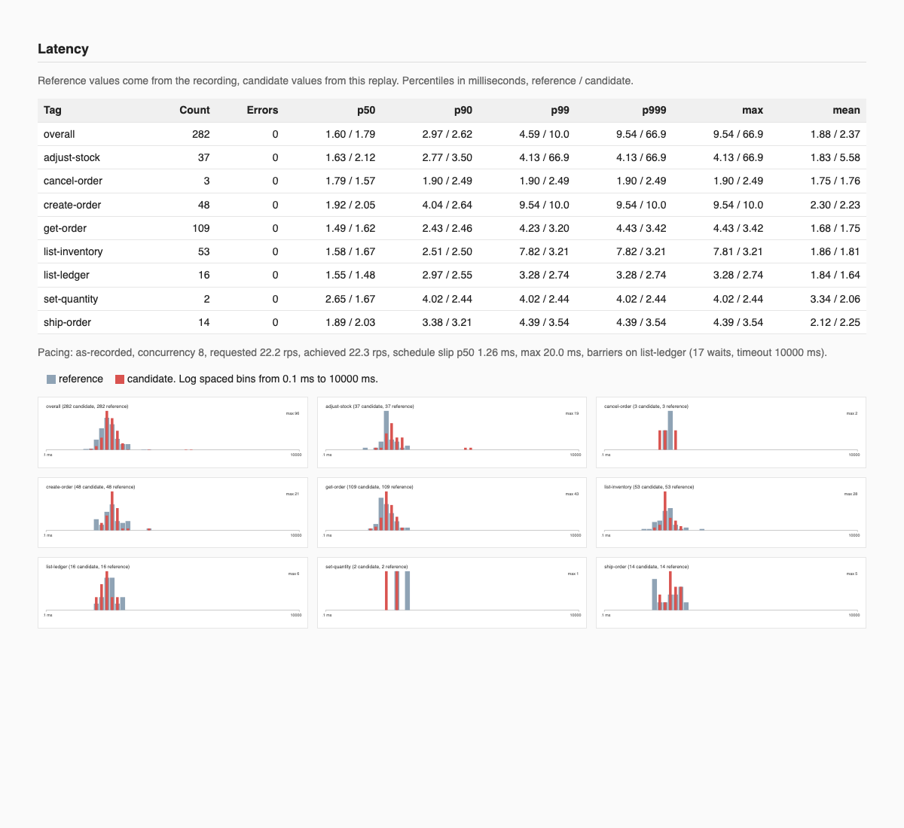
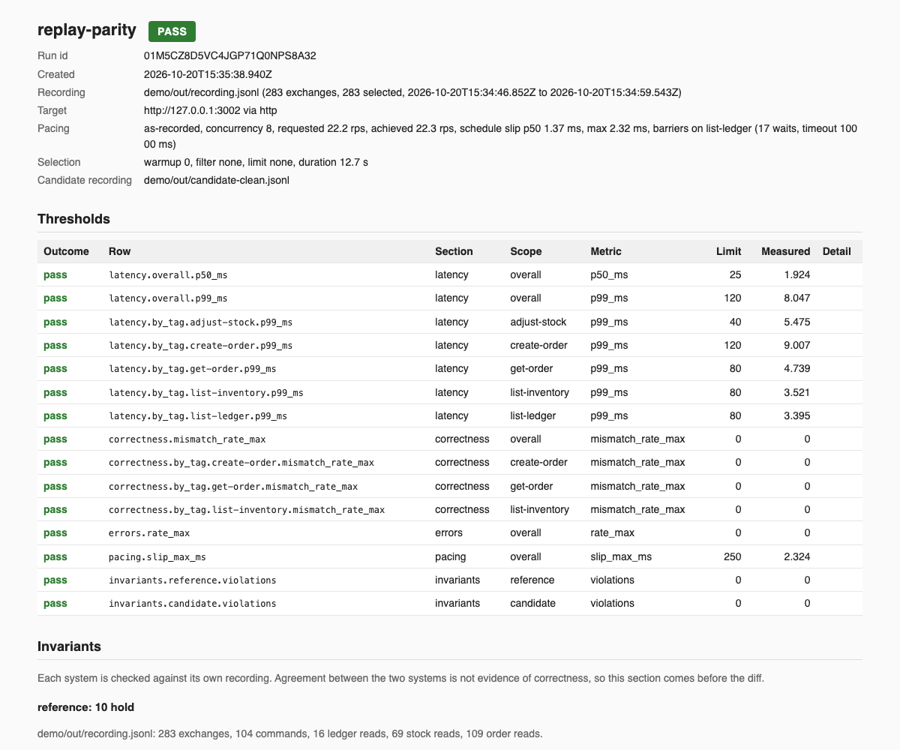
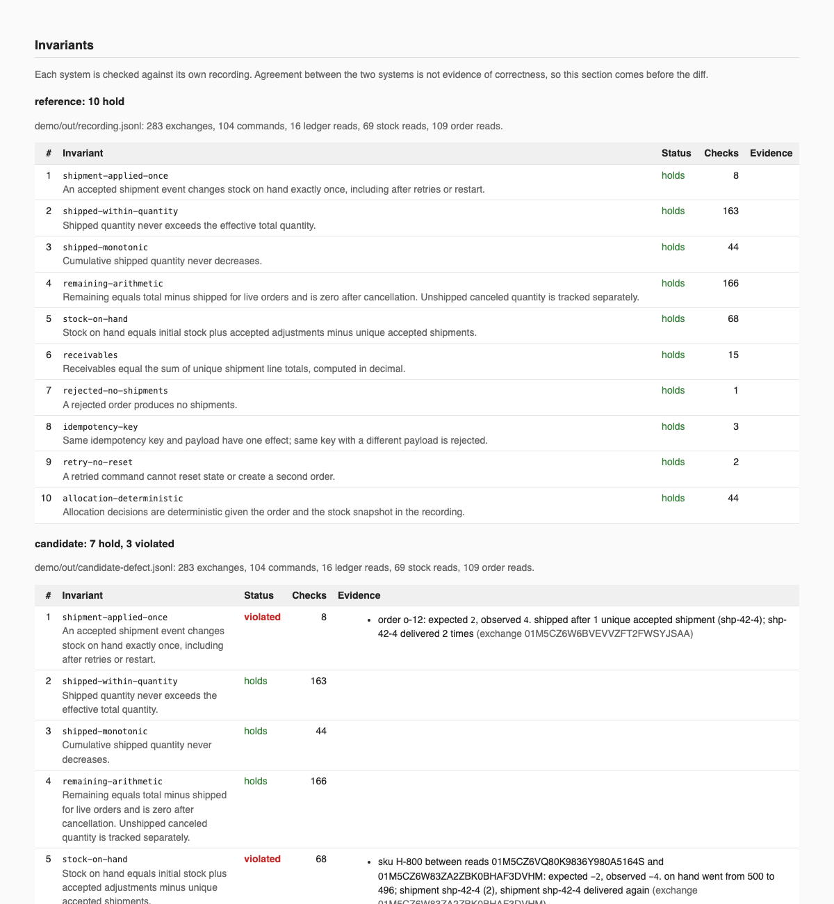
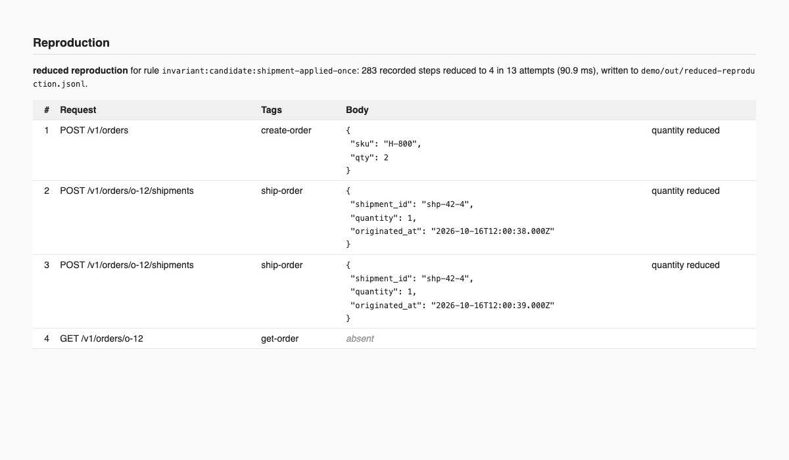
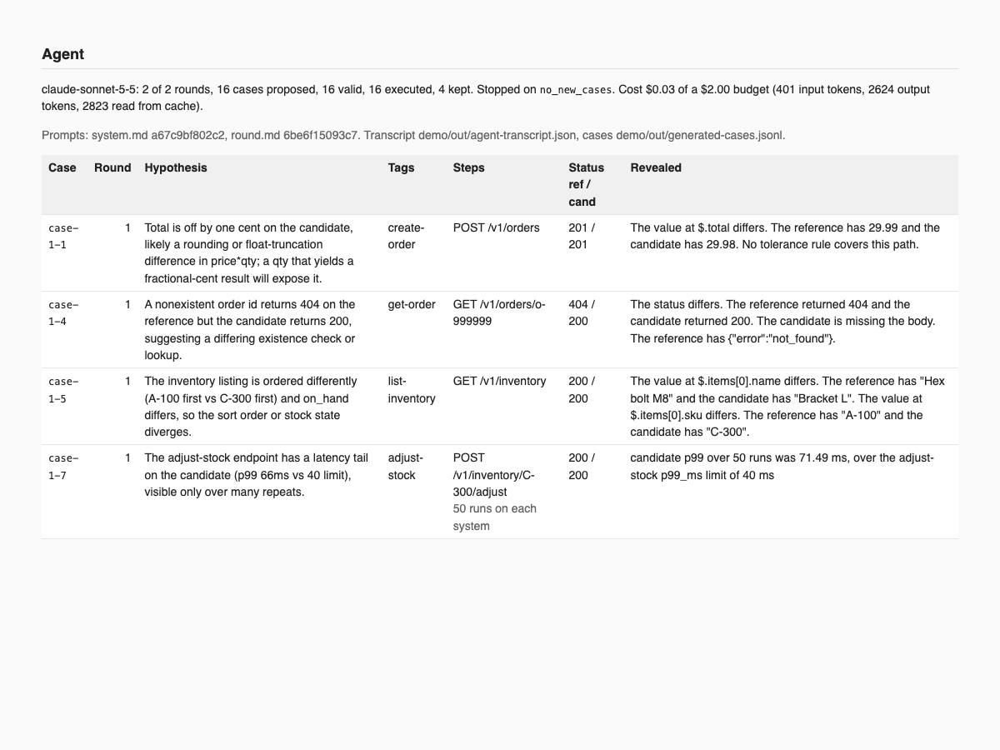

# The demo

`make demo` builds the two services, records real traffic against the reference through the capture proxy, and replays it three times against three candidates. The whole run takes about ninety seconds once the images are built. The first build of the images takes a few minutes.

## What runs

1. `docker compose` starts four containers from `demo/docker-compose.yml`: the reference on port 3000, the candidate with the four planted divergences on 3001, a clean candidate with `DIVERGENCES=off` on 3002, and a candidate with one seeded defect on 3003.
2. `rp capture` listens on 8080 in front of the reference. The load generator in `demo/load` sends twelve order lifecycle scenarios with background traffic between them, a ledger read after each scenario, and a final read of every order and the ledger. The recording lands in `demo/out/recording.jsonl` with 284 exchanges across nine tags.
3. `rp replay` runs with `--config demo/rp.yaml` and the `strict` or `unordered` profile. The file holds the shared settings, `as-recorded` pacing, concurrency 8, the demo thresholds, `list-ledger` as a barrier tag, and the invariants on both recordings, and the profile names the rules file. The target, the run file, and the candidate recording differ per replay and stay on the command line. The runs and reports land in `demo/out`.

| Replay | Candidate                                       | Profile and rules                             | Expected verdict                          | Report                  |
| ------ | ----------------------------------------------- | --------------------------------------------- | ----------------------------------------- | ----------------------- |
| 1      | the four divergences                            | `strict`, `demo/diff-rules.yaml`              | FAIL on all four                          | `report.html`           |
| 1b     | the four divergences                            | `unordered`, `demo/diff-rules-unordered.yaml` | FAIL on three, ordering tolerated         | `report-unordered.html` |
| 2      | `DIVERGENCES=off`                               | `strict`, `demo/diff-rules.yaml`              | PASS, every invariant holds on both sides | `report-clean.html`     |
| 3      | `DEMO_DEFECT`, default `shipment-applied-twice` | `strict`, `demo/diff-rules.yaml`              | FAIL on invariants, then `rp shrink`      | `report-defect.html`    |

`make demo` exits 0 when every step ran. A failing or inconclusive replay is a result, not an error. `make demo-down` stops the containers.

## The four planted divergences

Each one is a marked line in `demo/candidate-service/src/app.ts`. The candidate is derived from the reference and `scripts/check-parallel.sh` fails when the two files differ anywhere else.

### Rounding

Order totals are rounded half to even instead of half up, so a subset of orders differs by one cent. The correctness section lists the `create-order` exchanges that differ on `$.total` and the `get-order` reads of the same orders. In the recorded run seven creates and twenty three reads differ.



### Ordering

`GET /v1/inventory` returns rows in insertion order instead of SKU order. Under `demo/diff-rules.yaml` every one of the 53 inventory reads mismatches on `$.items[*]`. Under `demo/diff-rules-unordered.yaml`, which compares `$.items` as a set keyed by `$.sku`, the same reads match and the `list-inventory` row passes.



### Latency

`POST /v1/inventory/:sku/adjust` sleeps 60 ms on a seeded five percent of calls. The threshold row `latency.by_tag.adjust-stock.p99_ms` fails against its 40 ms limit, and the latency table shows the candidate's p99 and max for the tag next to the reference values from the recording.





### Behavior

`GET /v1/orders/:id` on an unknown id returns 200 with an empty body instead of 404. The correctness drill down shows status 404 against 200 for each of the eight unknown id lookups the load generator makes.

## The clean pair

The second replay targets the candidate started with `DIVERGENCES=off`. Every threshold row passes and the invariants section shows ten rules holding on the reference and ten on the candidate.



## The seeded defect

The third replay targets a candidate with one of the four seeded defects enabled, `shipment-applied-twice` unless `DEMO_DEFECT` names another. The diff sees it, but the invariants section names what went wrong from the candidate's own recording alone: invariant 1 finds an order whose shipped quantity counts one shipment twice, invariant 5 finds the stock interval that moved by one shipment too many, and invariant 6 finds the receivables interval with the extra line total.



`rp shrink` then replays subsets of the recording against the reset candidate, judged by invariant 1, and writes the reduced reproduction. The recorded 284 steps come down to four in thirteen attempts: create an order, deliver a shipment, deliver the same shipment id again, read the order.



`fixtures/defects/<name>/cause.md` names each defect's mechanism, its marked line, and the invariant expected to catch it.

## The agent

With `ANTHROPIC_API_KEY` set, `make demo` runs `rp agent` for two rounds against the classic candidate after the first replay and renders `report.html` again with the agent section. The model receives the run summary, one request shape per tag, and the kept cases, and answers with new cases. Each case is sent to both systems, as many times as its `repeat` says, and kept when it reveals a mismatch path set or a latency breach that no kept case already reveals. The transcript lands in `demo/out/agent-transcript.json`. `docs/agent-loop.md` explains the loop and shows a real transcript.



## Knobs

| Variable                                                                                               | Default                      | Effect                                                                                                                                                                                                                                                                                                                              |
| ------------------------------------------------------------------------------------------------------ | ---------------------------- | ----------------------------------------------------------------------------------------------------------------------------------------------------------------------------------------------------------------------------------------------------------------------------------------------------------------------------------- |
| `DIVERGENCES`                                                                                          | `on`                         | Divergences of the main candidate: `on`, `off`, or a comma separated list of names. `DIVERGENCES=off make demo` makes the first replay pass.                                                                                                                                                                                        |
| `DEMO_DEFECT`                                                                                          | `shipment-applied-twice`     | The seeded defect of the third candidate: `shipment-applied-twice`, `quantity-as-additional`, `drop-late-precancel-shipment`, or `idempotency-lost-on-restart`.                                                                                                                                                                     |
| `DEMO_REFERENCE_PORT`, `DEMO_CANDIDATE_PORT`, `DEMO_CLEAN_PORT`, `DEMO_DEFECT_PORT`, `DEMO_PROXY_PORT` | 3000, 3001, 3002, 3003, 8080 | Host ports.                                                                                                                                                                                                                                                                                                                         |
| `ANTHROPIC_API_KEY`                                                                                    | unset                        | When set, in the shell or in a gitignored `.env` at the repository root, the agent runs two rounds after the first replay and adds its findings to `report.html`.                                                                                                                                                                   |
| `demo/rp.yaml`                                                                                         | the committed file           | The shared replay settings, with the `strict` profile naming `demo/diff-rules.yaml` and the `unordered` profile naming `demo/diff-rules-unordered.yaml`. `scripts/demo.sh` passes `--config demo/rp.yaml --profile <name>` on every replay, so an edit to the file changes every replay, and `examples/rp.yaml` explains every key. |
| `RP_REPLAY_<FLAG>`                                                                                     | unset                        | A variable for any `rp replay` flag sits above the profile and below the command line, so `RP_REPLAY_CONCURRENCY=4 make demo` changes the pool without editing the file. The target, the run file, and the candidate recording are passed as flags by the script and win over a variable.                                           |

## Measured on this machine

Apple M4 Max, 16 cores, Docker Desktop 29.4.1 with a linux/aarch64 engine. Commands and figures from the run recorded in the changelog.

| Measurement       | Command              | Result                                                                                                                                                                                              |
| ----------------- | -------------------- | --------------------------------------------------------------------------------------------------------------------------------------------------------------------------------------------------- |
| Capture overhead  | `make bench-capture` | p50 direct 0.26 to 0.31 ms, p50 through the proxy 0.54 to 0.59 ms, overhead p50 0.28 ms and p99 1.06 ms, over 5000 requests at concurrency 8 after 500 warmup, two passes each                      |
| Replay throughput | `make bench-replay`  | 2600 to 3200 requests per second at `max` pacing with concurrency 8 over the committed recording, zero mismatches against the clean candidate                                                       |
| Schedule slip     | `make demo`          | p50 1.6 ms and max 3.5 ms on the clean pair under `as-recorded` pacing; max 27 to 36 ms on the classic candidate, where the 60 ms delays hold back the requests that followed them in the recording |

## Without Docker

The committed `demo/recording.jsonl` replays against the candidate in process. `pnpm test` runs that flow in `demo/load/test/demo.int.test.ts`, and `rp replay --recording demo/recording.jsonl --target <url>` works against any running candidate.

The two services also start with node directly after `pnpm build`. Each reads its port from `PORT`, the candidate reads `DIVERGENCES` and `DIVERGENCE_SEED`, both answer `/healthz`, and both accept `POST /admin/reset`:

```sh
PORT=3100 node demo/reference-service/dist/src/server.js &
PORT=3101 DIVERGENCES=on node demo/candidate-service/dist/src/server.js &
node packages/cli/dist/src/main.js replay --recording demo/recording.jsonl --target http://127.0.0.1:3101 \
  --rules demo/diff-rules.yaml --thresholds demo/thresholds.yaml --barrier-tag list-ledger --out run.json
```

A one round agent smoke was run that way on this machine: the committed recording replayed at `max` pacing against the reference on 3100 and the classic candidate on 3101, then `rp agent` against the candidate's run with four cases per round, one round, a fifty cent budget, and `--export-recording`. The model proposed four cases and all four were kept, the one cent difference on `$.total`, the inventory ordering, the unknown id answered 200 with no body, and the `adjust-stock` p99 over 40 runs at 62.9 ms against the 40 ms limit, for $0.0159, and the exported recording of four exchanges passed `rp recording validate`.
