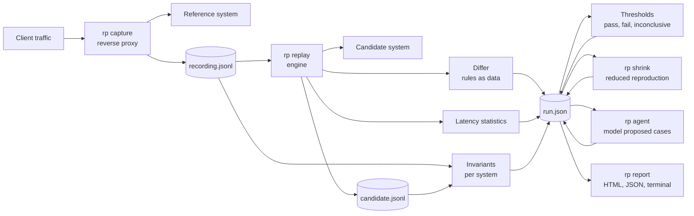

# Architecture

replay-parity answers one question: does the candidate system behave like the reference system on real traffic, fast enough. It does so with recorded traffic, a replay, a structural diff, latency statistics, gates, independent invariants, a reduced reproduction, and a report. This page names the parts and the decisions behind them.

## The pipeline

Every arrow is a file or a function call inside one process. Nothing talks to a database or a queue unless the bus adapter is chosen.

## Packages

| Package      | Holds                                                                                                                                                                                                                                                                                            | Depends on               |
| ------------ | ------------------------------------------------------------------------------------------------------------------------------------------------------------------------------------------------------------------------------------------------------------------------------------------------ | ------------------------ |
| `core`       | The recording format and its JSON Lines reader and writer, the JSONPath subset, the diff rules schema, the differ, latency statistics on HDR histograms with fixed log spaced bins, the thresholds schema and evaluator, the run model and its JSON Schema, the verdict rule, and test fixtures. | nothing in the workspace |
| `capture`    | The reverse proxy: forwards every request, streams the response back unchanged, records the exchange in arrival order, applies tag rules, sampling, redaction, and the body size cap.                                                                                                            | core                     |
| `replay`     | The engine with three pacing modes, a bounded pool, barriers and harness controls, substitutions with a dependency index, the recorded happens-before rule, the HTTP adapter, the bus adapter with an in process bus and a Redis Streams bus, and the candidate recording writer.                | core, invariants         |
| `invariants` | The command parser, the per system model built from acknowledgements, the ten rules, and the completion check.                                                                                                                                                                                   | core                     |
| `shrink`     | Delta debugging over recorded steps with a prerequisite closure and a quantity lowering pass.                                                                                                                                                                                                    | core, replay             |
| `report`     | The terminal, HTML, and JSON renderers and the SVG histogram.                                                                                                                                                                                                                                    | core                     |
| `agent`      | The model client contract, the Anthropic client, the mock, pricing, prompts, validation, the two system executor, and the round loop.                                                                                                                                                            | core, replay             |
| `cli`        | The `rp` binary.                                                                                                                                                                                                                                                                                 | every package            |

The demo services, the load generator, and the repository scripts live outside `packages/`.

## Decisions

**JSON Lines for recordings.** One exchange per line, append only, valid when every line parses and `offset_ms` never decreases. A capture that dies mid write loses one line and nothing else. A recording can be split, sampled, filtered, and diffed in git with ordinary tools. The reader streams, so a recording larger than memory still replays.

**Diff rules are data.** A rules file names what to ignore, which numbers tolerate how much, which arrays are sets and by which key, which statuses are equivalent, which headers to compare, which values are substituted, and which tags are harness controls. The differ reports the path, both values, and the rule that tolerated a difference, in a deterministic order. A reviewer can read the rules and the findings without reading code, and two runs with the same rules diff cleanly.

**Stateful sequences.** A substitution rule captures a value, such as an order id, from the response of every exchange carrying a tag, on the reference side from the recording and on the candidate side from the replay. Later requests have the reference value replaced with the candidate value in the path, the query, and the body, and the differ treats the pair as equivalent. The engine computes the dependencies before anything is sent and waits for the producer under every pacing mode. The first exchange to produce a reference value wins, so a retry that yields a different candidate id is a mismatch rather than a silent remap.

**The recorded order is kept.** An exchange that began after an earlier exchange's response in the recording is never sent before that exchange is acknowledged. Exchanges that overlapped in the recording may overlap again. Without this rule a slow candidate response let the next read overtake the write it followed, and the stale read looked like a defect.

**Barriers and harness controls.** A barrier tag makes an exchange wait until every earlier exchange has a response or an error, run alone, and be acknowledged before anything later is sent. A wait past the timeout makes the run inconclusive. A harness control, such as a restart, is a barrier that is diffed on status only, excluded from statistics and thresholds, and shown in the report in sequence without a score.

**Three verdicts.** A run passes, fails, or is inconclusive. Fail means a verified difference, a breached threshold, or an invariant violation. Inconclusive means the harness could not decide: a barrier timed out, a snapshot was read while a command was in flight, the schedule was not held, a control failed, or a latency row had fewer successful samples than its minimum. A run level condition wins over observed mismatches, because those may be artifacts. The exit codes are 0, 2, 3, and 1 for a tool error.

**Independent invariants.** Agreement between two systems is not evidence of correctness. Each system's recording is checked on its own against rules written from the domain's definitions, using only that system's acknowledgements to rebuild the expected state. The report shows the result per system above the diff. The rules are specific to the demo's order lifecycle, and another domain needs its own.

**Reduced, not minimal.** Shrinking removes recorded steps with delta debugging, re-adds what any kept step needs, lowers quantities toward one, and replays every candidate against a reset system, judged by the same rule. The result is shorter and still fails. Nothing proves it is the shortest, so the report says reduced reproduction and never minimal.

**The agent is bounded.** One model call per round, a schema that drops anything malformed, a per call cost from a static table, a stop before a call that could cross the budget, and a transcript with prompt versions. The model sees redacted headers and nothing from the repository tree.

**Reports open offline.** One HTML file with inline CSS and SVG, no script, no external resource. The JSON run is the canonical form and the HTML and terminal views are rendered from it.

## Adding a transport

`docs/writing-adapters.md` describes the adapter contract, the HTTP adapter, the bus adapter, and the responder a system under test runs for the bus.
