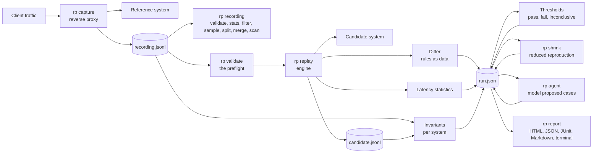

# Architecture

replay-parity answers one question: does the candidate system behave like the reference system on real traffic, fast enough. It does so with recorded traffic, a replay, a structural diff, latency statistics, gates, independent invariants, a reduced reproduction, and a report. This page names the parts and the decisions behind them.

## The pipeline

Every arrow is a file or a function call inside one process. Nothing talks to a database or a queue unless the bus adapter is chosen. `rp recording` and `rp validate` read files and send nothing but the probes `rp validate` is asked for; the preflight is the same checks, run by `rp replay`, `rp shrink`, and `rp agent` before their first request.

## Packages

| Package      | Holds                                                                                                                                                                                                                                                                                                                                                                                                                                                              | Depends on               |
| ------------ | ------------------------------------------------------------------------------------------------------------------------------------------------------------------------------------------------------------------------------------------------------------------------------------------------------------------------------------------------------------------------------------------------------------------------------------------------------------------ | ------------------------ |
| `core`       | The recording format and its JSON Lines reader and writer, the recording hash and the operations behind `rp recording`, header and query redaction, the JSONPath subset with quoted keyed segments, the diff rules schema, the differ, latency statistics on HDR histograms with fixed log spaced bins, the thresholds schema and evaluator, the run model with its JSON Schema and the migration of older run files on read, the verdict rule, and test fixtures. | nothing in the workspace |
| `capture`    | The reverse proxy: forwards every request with its body streamed upstream as it arrives, streams the response back unchanged, records the exchange in arrival order, applies tag rules, sampling, header and query redaction, and the body size cap through a running hash so a body costs at most the cap in memory, and bounds the wait for an upload the upstream never reads.                                                                                  | core                     |
| `replay`     | The engine with three pacing modes, a cap on recorded gaps, a bounded pool, barriers and harness controls, substitutions with a dependency index that also selects the producers a filtered replay needs, the recorded happens-before rule, a clean stop on a signal, query overrides, the recording hash written into the run, the HTTP adapter, the bus adapter with an in process bus and a Redis Streams bus, and the candidate recording writer.              | core, invariants         |
| `invariants` | The command parser, the per system model built from acknowledgements, the ten rules, and the completion check.                                                                                                                                                                                                                                                                                                                                                     | core                     |
| `shrink`     | Delta debugging over recorded steps with a prerequisite closure and a quantity lowering pass, the recording hash check, and a stop on a signal that keeps the best reduction so far.                                                                                                                                                                                                                                                                               | core, replay             |
| `report`     | The terminal, HTML, JSON, JUnit, and Markdown renderers, the drill down plan that caps the HTML at 200 mismatched exchanges, and the SVG histogram.                                                                                                                                                                                                                                                                                                                | core                     |
| `agent`      | The model client contract, the Anthropic client with schema constrained answers, server side fallbacks, and exact token counts, the mock, the dated price table, prompts, validation, the two system executor with resets and case concurrency, the recording export, and the round loop.                                                                                                                                                                          | core, replay             |
| `cli`        | The `rp` binary: the nine commands, the configuration layers from `rp.yaml`, profiles, and `RP_` variables with `${NAME}` interpolation, the preflight, and the signal that stops every command cleanly.                                                                                                                                                                                                                                                           | every package            |

The demo services, the load generator, and the repository scripts live outside `packages/`, and so do `examples/rp.yaml` and `demo/rp.yaml`, the root `Dockerfile` that builds the `rp` image, and the CI and release workflows under `.github/`.

## Decisions

Each decision below also has a record in `docs/adr/`, with its status, the date of the commit that introduced it, and its context and consequences.

**JSON Lines for recordings.** One exchange per line, append only, valid when every line parses and `offset_ms` never decreases. A capture that dies mid write loses one line and nothing else. A recording can be split, sampled, filtered, and diffed in git with ordinary tools. The reader streams, so a recording larger than memory still replays.

**Diff rules are data.** A rules file names what to ignore, which numbers tolerate how much, which arrays are sets and by which key, which statuses are equivalent, which headers to compare, which values are substituted, and which tags are harness controls. The differ reports the path, both values, and the rule that tolerated a difference, in a deterministic order. A reviewer can read the rules and the findings without reading code, and two runs with the same rules diff cleanly.

**Stateful sequences.** A substitution rule captures a value, such as an order id, from the response of every exchange carrying a tag, on the reference side from the recording and on the candidate side from the replay. Later requests have the reference value replaced with the candidate value in the path, the query, and the body, and the differ treats the pair as equivalent. The engine computes the dependencies before anything is sent and waits for the producer under every pacing mode. The first exchange to produce a reference value wins, so a retry that yields a different candidate id is a mismatch rather than a silent remap.

**The recorded order is kept.** An exchange that began after an earlier exchange's response in the recording is never sent before that exchange is acknowledged. Exchanges that overlapped in the recording may overlap again. Without this rule a slow candidate response let the next read overtake the write it followed, and the stale read looked like a defect. With a session key the rule holds within a session, as below.

**Sessions run side by side.** `--session-key` names where a recorded request carries its session: a header, a cookie, or a JSONPath into the request body. Sends start in recording order within a session, the recorded order above holds within a session, and sessions overlap up to `--concurrency`. A recording made by many independent clients then replays at the rate of many clients without inventing an order between two requests of one client, and without keeping the order the recording happened to have between clients. What still orders across sessions is what the recording cannot speak for: barrier tags and controls wait for every earlier exchange of every session and hold back every later one, and a request that uses a substituted value waits for the exchange that produced it in whichever session it ran. The exchanges whose request has no value at the key form one session of their own, so the key never frees an exchange it cannot place. Without the flag the whole recording is one session and the replay is the one it always was. The engine runs one worker per session with work in the window, so a session whose next exchange waits does not hold up the others.

**Barriers and harness controls.** A barrier tag makes an exchange wait until every earlier exchange of every session has a response or an error, run alone, and be acknowledged before anything later in any session is sent. A wait past the timeout makes the run inconclusive. A harness control, such as a restart, is a barrier that is diffed on status only, excluded from statistics and thresholds, and shown in the report in sequence without a score.

**The reference is replayed too, to tell noise apart.** With `--reference-target` every exchange goes to the reference as well as the candidate, at the same moment, in the same order, with the reference's own substitution table built from its own answers. A path where the reference differs from its own recording moved by itself, as a timestamp or a fresh id does, and the same difference on the candidate is tolerated as `noise:reference` and marked `noise: true` instead of failing the run. Without this a timestamp failed every candidate until someone wrote an ignore rule, and the comparison set the proxy's view of the reference on the day of the capture against the candidate on the day of the replay. A reference that answered another status, a body of another format, or no answer names no noise at all, so a broken reference cannot excuse a candidate broken the same way. An exchange is acknowledged once both systems answered, so every ordering rule holds for the reference too.

**The recording and the results stream.** The engine never holds the whole recording. A first pass over the file validates every line, counts the exchanges, and chooses the selection, so a file that does not parse still sends nothing. Each replay pass reads the file again through a window of at most `--window` exchanges (10000 by default) past the oldest one not yet acknowledged, and the dependency index and the happens-before checks are answered from what the window holds: a producer always precedes the requests that use its value, so building the index as the window fills gives the producers a whole selection would. A window too small costs overlap, not correctness: while the oldest exchange is slow nothing past the window is read, so other sessions and overlapping exchanges wait with slots free. Results leave the window in recording order. Above 50000 results, or with `--exchanges-sidecar`, they stream to a JSON Lines sidecar next to the run, and the run file keeps the summary and a sample of the mismatches, so a run of millions of exchanges writes a run file of kilobytes and `rp report` reads the sidecar back. What still grows with the run is small and named: one number per exchange for the schedule slip, the substitution tables, and, with a filter and dependencies, the producers of each dependent exchange in the first pass. The preflight of `rp replay`, the candidate recording, and the invariants read whole recordings and are the exceptions.

**A stopped run resumes.** A run that uses the sidecar writes a checkpoint every 1000 acknowledgements and when a signal stops it: the end of the acknowledged prefix, the sidecar bytes that hold it, the substitution tables as that prefix left them, and the conditions it produced. A send the stop cut short is not part of the prefix. `--resume` refuses a different recording or any option that shapes the results, truncates the sidecar to the prefix, rebuilds the statistics from it, and sends the rest, so the resumed run ends with the verdict, counts, and findings of a run that was never stopped. The exchanges after the prefix are sent again, which a stateful candidate sees twice unless it is reset first.

**Three verdicts.** A run passes, fails, or is inconclusive. Fail means a verified difference, a breached threshold, or an invariant violation. Inconclusive means the harness could not decide: a barrier timed out, a snapshot was read while a command was in flight, the schedule was not held, a control failed, the run was stopped by a signal, or a latency row had fewer successful samples than its minimum. A run level condition wins over observed mismatches, because those may be artifacts. The exit codes are 0, 2, 3, and 1 for a tool error.

**A signal stops the run cleanly.** The first SIGINT or SIGTERM aborts one controller that the CLI passes to every command, and a second signal exits at once with 130. The engine sends nothing more, aborts the sends in flight, and finishes the run with the results so far and an `aborted` condition naming how many of the selected exchanges were sent, so the partial run is written and the command exits 3. The shrink cuts the attempt in progress short, keeps the best reduction confirmed so far, and still writes the reduced recording. The agent checks the signal before each round and each case and stops at the next boundary with the stop reason `aborted`, so the transcript, the cases, and the agent section are written. A stopped run is inconclusive, never a pass or a fail, because the harness did not see everything.

**The run names its recording.** `rp replay` hashes the recording file in a streaming pass alongside the read and writes the SHA-256 of its bytes into the run as `recording.recording_sha256`. An edited, appended, filtered, or reordered file has a different hash. `rp shrink` hashes the file it is given and refuses one whose hash differs from the run's, naming both hashes, unless `--allow-recording-mismatch` turns the refusal into a warning. A run built from exchanges in memory carries null and accepts any file, and a run written before the field existed still parses, because the field is optional and older run files are migrated on read.

**Configuration is layered and checked first.** Every long flag of every command can be a key in `rp.yaml` under the command's name. A profile overrides the top level, an `RP_<COMMAND>_<FLAG>` variable overrides the profile, and a flag on the command line overrides everything, with a list replaced whole at each layer. The schema is derived from the registered commander options, so an unknown key or a value a flag's parser rejects is an error naming the key, and the merged values are applied to the command's options before it parses, so required flags and choice lists see them as typed values. Any string may hold `${NAME}`, resolved from the environment when the command runs and never written to the run, the candidate recording, or the output of `rp doctor`. Before anything is sent, `rp validate`, and the same preflight inside `rp replay`, `rp shrink`, and `rp agent`, checks that every tag the thresholds name, every substitution capture tag, every control tag, every rule path, and every barrier tag matches the recording, and probes the URLs it is asked to; an error exits 1 with no run file, so a misspelled tag fails at the start rather than as an inconclusive row at the end. `--no-preflight` keeps the earlier behavior for a recording that legitimately lacks a tag.

**Independent invariants.** Agreement between two systems is not evidence of correctness. Each system's recording is checked on its own against rules written from the domain's definitions, using only that system's acknowledgements to rebuild the expected state. The report shows the result per system above the diff. The rules are specific to the demo's order lifecycle, and another domain needs its own.

**Reduced, not minimal.** Shrinking removes recorded steps with delta debugging, re-adds what any kept step needs, lowers quantities toward one, and replays every candidate against a reset system, judged by the same rule. The result is shorter and still fails. Nothing proves it is the shortest, so the report says reduced reproduction and never minimal.

**The agent is bounded.** One model call per round, a schema that drops anything malformed, a per call cost from a static table, a stop before a call that could cross the budget, and a transcript with prompt versions. The model sees redacted headers and nothing from the repository tree.

**Reports open offline.** One HTML file with inline CSS and SVG, no script, no external resource, and at most 200 mismatched exchanges in the drill down, taken round robin across the top paths so every path is represented. The JSON run is the canonical form and the HTML, terminal, JUnit, and Markdown views are rendered from it, so the same run always produces the same bytes in every format.

## Adding a transport

`docs/writing-adapters.md` describes the adapter contract, the HTTP adapter, the bus adapter, and the responder a system under test runs for the bus.
